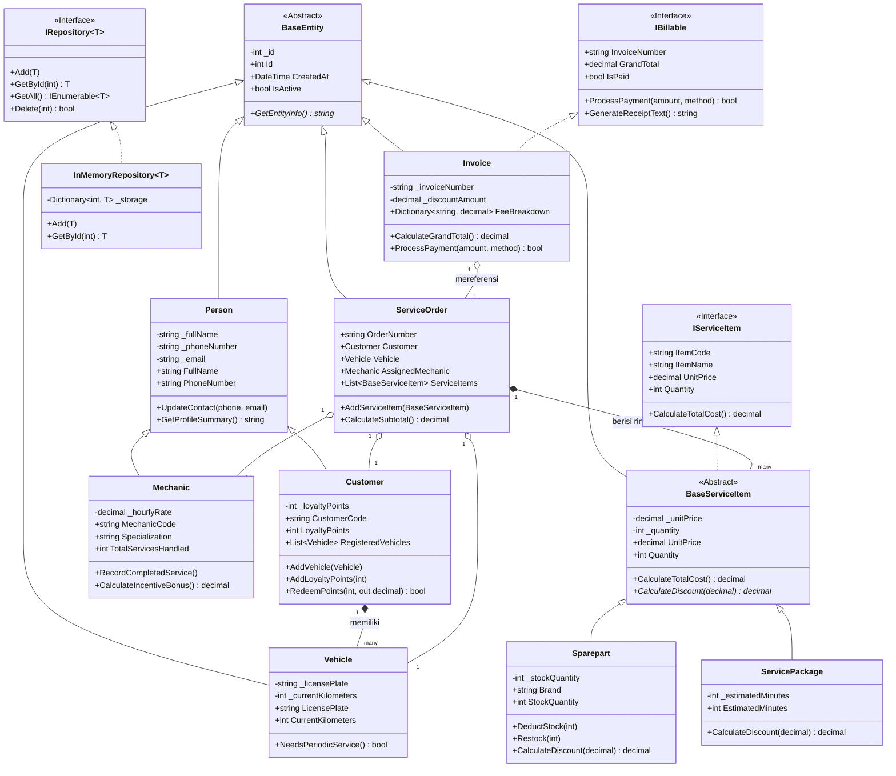

# Laporan Progress Tugas Besar Pemrograman II (PBO .NET C#)
## MotoCare – Sistem Informasi Manajemen Bengkel Motor

> [!NOTE]
> Dokumen ini disusun untuk memenuhi syarat pengumpulan form progress tugas besar di **Edlink** dengan tema **MotoCare (Sistem Informasi Manajemen Bengkel Motor)** berbasis **C# ASP.NET Core MVC & MySQL**.

---

### Informasi Kelompok & Pembagian Tugas Anti-Bentrok

Untuk memastikan proses pengembangan berjalan lancar dan **tidak terjadi konflik file (merge conflict)** di Git saat dikerjakan bersama, proyek dibagi ke dalam 3 modul independen dengan batas tanggung jawab yang tegas:

| No | Anggota Kelompok | Peran & Modul | Direktori File | Tanggung Jawab & Konsep OOP |
|:--:|:-----------------|:--------------|:---------------|:----------------------------|
| 1 | **Izat Ibrahimovic** | **Lead Modul 1:** Master Data Entitas | `Models/Modul1_MasterData/` | Mengembangkan entitas induk [`Person`](file:///C:/Users/Lenovo/.gemini/antigravity/worktrees/-Sistem-Informasi-Manajemen-Bengkel-Motor-Motocare/motocare_oop_documentation/src/MotoCare/Models/Modul1_MasterData/Person.cs), [`Customer`](file:///C:/Users/Lenovo/.gemini/antigravity/worktrees/-Sistem-Informasi-Manajemen-Bengkel-Motor-Motocare/motocare_oop_documentation/src/MotoCare/Models/Modul1_MasterData/Customer.cs), [`Mechanic`](file:///C:/Users/Lenovo/.gemini/antigravity/worktrees/-Sistem-Informasi-Manajemen-Bengkel-Motor-Motocare/motocare_oop_documentation/src/MotoCare/Models/Modul1_MasterData/Mechanic.cs), dan [`Vehicle`](file:///C:/Users/Lenovo/.gemini/antigravity/worktrees/-Sistem-Informasi-Manajemen-Bengkel-Motor-Motocare/motocare_oop_documentation/src/MotoCare/Models/Modul1_MasterData/Vehicle.cs). Fokus pada **Variable Get/Set**, **Inheritance**, dan **Collection** `List<Vehicle>`. |
| 2 | **Putrana Yudhistira** | **Lead Modul 2:** Operasional Servis & Inventaris | `Models/Modul2_OperasionalServis/` | Mengembangkan [`IServiceItem`](file:///C:/Users/Lenovo/.gemini/antigravity/worktrees/-Sistem-Informasi-Manajemen-Bengkel-Motor-Motocare/motocare_oop_documentation/src/MotoCare/Models/Modul2_OperasionalServis/Interfaces/IServiceItem.cs), [`BaseServiceItem`](file:///C:/Users/Lenovo/.gemini/antigravity/worktrees/-Sistem-Informasi-Manajemen-Bengkel-Motor-Motocare/motocare_oop_documentation/src/MotoCare/Models/Modul2_OperasionalServis/Abstracts/BaseServiceItem.cs), [`Sparepart`](file:///C:/Users/Lenovo/.gemini/antigravity/worktrees/-Sistem-Informasi-Manajemen-Bengkel-Motor-Motocare/motocare_oop_documentation/src/MotoCare/Models/Modul2_OperasionalServis/Sparepart.cs), [`ServicePackage`](file:///C:/Users/Lenovo/.gemini/antigravity/worktrees/-Sistem-Informasi-Manajemen-Bengkel-Motor-Motocare/motocare_oop_documentation/src/MotoCare/Models/Modul2_OperasionalServis/ServicePackage.cs), dan [`ServiceOrder`](file:///C:/Users/Lenovo/.gemini/antigravity/worktrees/-Sistem-Informasi-Manajemen-Bengkel-Motor-Motocare/motocare_oop_documentation/src/MotoCare/Models/Modul2_OperasionalServis/ServiceOrder.cs). Fokus pada **Interface**, **Abstract Class**, dan **Polymorphism**. |
| 3 | **Rafli Apriliandi** | **Lead Modul 3:** Transaksi & Generic Repository | `Models/Modul3_TransaksiDanRepository/` | Mengembangkan [`IBillable`](file:///C:/Users/Lenovo/.gemini/antigravity/worktrees/-Sistem-Informasi-Manajemen-Bengkel-Motor-Motocare/motocare_oop_documentation/src/MotoCare/Models/Modul3_TransaksiDanRepository/Interfaces/IBillable.cs), [`IRepository<T>`](file:///C:/Users/Lenovo/.gemini/antigravity/worktrees/-Sistem-Informasi-Manajemen-Bengkel-Motor-Motocare/motocare_oop_documentation/src/MotoCare/Models/Modul3_TransaksiDanRepository/Interfaces/IRepository.cs), [`InMemoryRepository<T>`](file:///C:/Users/Lenovo/.gemini/antigravity/worktrees/-Sistem-Informasi-Manajemen-Bengkel-Motor-Motocare/motocare_oop_documentation/src/MotoCare/Models/Modul3_TransaksiDanRepository/Repositories/InMemoryRepository.cs), [`Invoice`](file:///C:/Users/Lenovo/.gemini/antigravity/worktrees/-Sistem-Informasi-Manajemen-Bengkel-Motor-Motocare/motocare_oop_documentation/src/MotoCare/Models/Modul3_TransaksiDanRepository/Invoice.cs), dan [`ServicePricingCatalog`](file:///C:/Users/Lenovo/.gemini/antigravity/worktrees/-Sistem-Informasi-Manajemen-Bengkel-Motor-Motocare/motocare_oop_documentation/src/MotoCare/Models/Modul3_TransaksiDanRepository/ServicePricingCatalog.cs). Fokus pada **Generic**, **Dictionary**, dan **Interface**. |

---

### Diagram Relasi Kelas (Class Diagram)

---

### Pemetaan & Pembuktian 4 Syarat Wajib Edlink

#### 1. Variable, Get, Set, Method (Enkapsulasi)
- **Field Variabel Privat (`private`)**: Mencegah akses langsung dari luar kelas (`_fullName`, `_phoneNumber`, `_licensePlate`, `_stockQuantity`, `_unitPrice`).
- **Property Get-Set dengan Validasi**:
  - `Id` pada `BaseEntity`: Mencegah nilai ID negatif.
  - `FullName` & `PhoneNumber` pada `Person`: Memastikan nama tidak kosong dan telepon minimal 9 karakter.
  - `LicensePlate` pada `Vehicle`: Mengonversi otomatis huruf kecil menjadi huruf kapital (`.ToUpper()`).
  - `StockQuantity` pada `Sparepart`: Melempar pengecualian jika stok dimasukkan negatif.
- **Private Setter (`private set`)**: Menjaga data sensitif seperti `LoyaltyPoints`, `GrandTotal`, dan `IsPaid` agar tidak diubah sepihak.
- **Business Methods**: `UpdateContact()`, `NeedsPeriodicService()`, `DeductStock()`, `CalculateSubtotal()`, `ProcessPayment()`.

#### 2. Inheritance (Pewarisan Kelas)
- **Hierarki Pengguna**: `Person` (Base Class) diturunkan ke `Customer` dan `Mechanic`.
- **Konstruktor Induk**: Memanfaatkan sintaks `: base(id, fullName, phoneNumber, email)`.
- **Method Overriding**: Virtual method `GetProfileSummary()` pada `Person` di-override secara spesifik oleh `Customer` dan `Mechanic` untuk menampilkan ringkasan data unik masing-masing.
- **Hierarki Item Servis**: `BaseEntity` -> `BaseServiceItem` -> `Sparepart` & `ServicePackage`.

#### 3. Interface & Abstract Class (Abstraksi)
- **Interface**:
  - `IServiceItem`: Kontrak bagi setiap komponen yang dapat dimasukkan ke dalam nota pengerjaan bengkel (`CalculateTotalCost()`).
  - `IBillable`: Kontrak transaksi finansial penagihan kasir (`CalculateGrandTotal()`, `ProcessPayment()`, `GenerateReceiptText()`).
  - `IRepository<T>`: Kontrak pola repositori generic untuk operasi database CRUD.
- **Abstract Class**:
  - `BaseEntity`: Menyediakan properti id dan waktu transaksi (`CreatedAt`, `UpdatedAt`) serta abstract method `GetEntityInfo()`.
  - `BaseServiceItem`: Mengimplementasikan `IServiceItem` dan memiliki abstract method `CalculateDiscount(decimal discountPercentage)` yang wajib diimplementasikan dengan batas diskon berbeda antara suku cadang fisik (maksimal 15%) dan paket jasa servis (maksimal 30%).

#### 4. Collection, Dictionary, Generic
- **Collection (`List<T>`)**:
  - `List<Vehicle>` pada `Customer`: Menyimpan daftar motor milik pelanggan (relasi *One-to-Many*).
  - `List<BaseServiceItem>` pada `ServiceOrder`: Menampung item pengerjaan servis dan suku cadang secara fleksibel (*Polymorphic Collection*).
- **Dictionary (`Dictionary<TKey, TValue>`)**:
  - `Dictionary<int, T>` pada `InMemoryRepository<T>`: Menyimpan data entitas dengan primary key integer untuk pencarian instan berkecepatan $O(1)$.
  - `Dictionary<string, decimal> FeeBreakdown` pada `Invoice`: Menyimpan rincian transparan komponen tagihan (Biaya Jasa, Suku Cadang, PPN 11%, Diskon, Grand Total).
  - `Dictionary<string, decimal>` pada `ServicePricingCatalog`: Kamus tarif standar jasa bengkel MotoCare.
- **Generic**:
  - Generic Interface: `IRepository<T> where T : BaseEntity`.
  - Generic Class: `InMemoryRepository<T> : IRepository<T> where T : BaseEntity`.
  - Generic Method: `LookupCatalog<TResult>(string code, Func<decimal, TResult> transformer)`.

---

TIP

Aturan Git:

Izat membuat branch git checkout -b feature/masterdata-izat

Putrana membuat branch git checkout -b feature/servis-putrana

Rafli membuat branch git checkout -b feature/transaksi-rafli

Karena setiap anggota hanya menyentuh folder modulnya masing-masing, ketika di-merge ke branch main, Git akan menggabungkannya secara otomatis tanpa konflik sama sekali!
